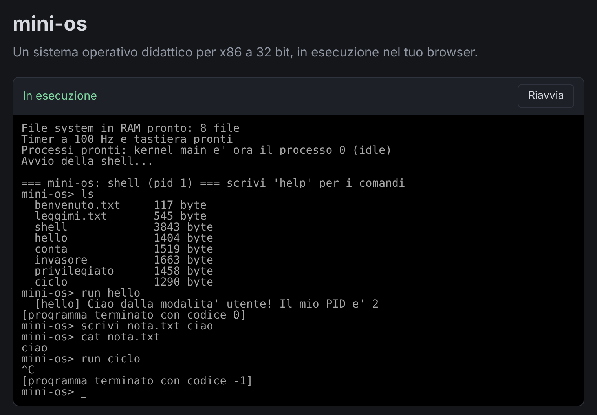
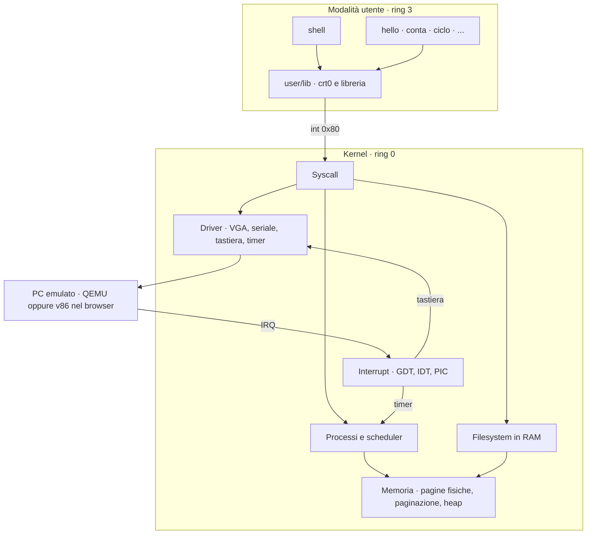

# mini-os

**Un sistema operativo didattico per x86 a 32 bit, scritto da zero in C e assembly: dal primo carattere a schermo fino a una shell che lancia programmi in modalità utente.**


mini-os è un kernel che si avvia con lo standard Multiboot, gestisce interrupt, memoria virtuale e processi, ed esegue programmi separati in modalità utente che gli parlano solo tramite chiamate di sistema. Sopra ci sono un filesystem in RAM e una shell. Non usa nessuna libreria: tutto ciò che serve, da `kprintf` a `kmalloc`, è scritto nel progetto.

**È pensato per essere letto: il codice è commentato in modo fitto, con i concetti di C spiegati a chi viene da Java e collegati alla teoria di Sistemi Operativi.**



---

## Architettura



Il contratto tra i due mondi è uno solo: **un programma utente non può chiamare funzioni del kernel né toccarne la memoria; può solo eseguire `int 0x80` con il numero di una syscall.** L'unico file condiviso è [`kernel/syscall_numbers.h`](kernel/syscall_numbers.h).

---

## Avvio rapido

Prerequisiti: Linux o WSL2 su un PC x86-64, con `gcc`, `nasm`, `make` e QEMU. Su Ubuntu:

```bash
sudo apt update && sudo apt install -y build-essential nasm qemu-system-x86 gdb
```

Scaricare, compilare e avviare:

```bash
git clone https://github.com/modugnoclaudio/mini-os.git
cd mini-os
make run
```

Si apre la finestra di QEMU e, dopo una ventina di righe di avvio, compare il prompt `mini-os> `.

| Comando | Cosa si ottiene |
|---|---|
| `make run` | Il sistema in una finestra di QEMU, con la shell pronta |
| `make test` | Tutte le prove automatiche in circa 2 secondi; l'ultima riga deve iniziare con `>>> TEST OK` |
| `make web-run` | La demo nel browser su http://localhost:8000 |

La tastiera è in layout americano: lettere, numeri, `-` e `.` coincidono con quella italiana, gli altri simboli no.

---

## Componenti

| Componente | Cartella | Cosa fa | Spiegazione |
|---|---|---|---|
| **Avvio** | [`boot/`](boot/) | Header Multiboot, stack, azzeramento della `.bss`, salto al C | [fase 1](docs/notes/fase1-boot.md) |
| **Output** | [`drivers/`](drivers/), [`lib/`](lib/) | Schermo VGA in modalità testo, seriale COM1, `kprintf` | [fase 1](docs/notes/fase1-boot.md) |
| **Interrupt** | [`kernel/`](kernel/), [`drivers/`](drivers/) | GDT, IDT, eccezioni, PIC, timer a 100 Hz, tastiera PS/2 | [fase 2](docs/notes/fase2-interrupt.md) |
| **Memoria** | [`mm/`](mm/) | Allocatore di pagine fisiche a bitmap, paginazione a due livelli, heap con `kmalloc` | [fase 3](docs/notes/fase3-memoria.md) |
| **Processi** | [`proc/`](proc/) | PCB, context switch, scheduler round-robin con prelazione | [fase 4](docs/notes/fase4-processi.md) |
| **Modalità utente** | [`kernel/`](kernel/), [`proc/`](proc/), [`user/`](user/) | Syscall, uno spazio di indirizzi per processo, programmi in ring 3 | [fase 5](docs/notes/fase5-modo-utente.md) |
| **Filesystem e shell** | [`fs/`](fs/), [`user/`](user/) | File in RAM, shell, `spawn`/`wait`, Ctrl+C | [fase 6](docs/notes/fase6-fs-shell.md) |
| **Demo web** | [`web/`](web/) | Il kernel dentro l'emulatore v86, in una pagina | [fase 7](docs/notes/fase7-demo-web.md) |

---

## Come funziona

| Meccanismo | Come è realizzato |
|---|---|
| **Avvio** | QEMU (o v86) fa da bootloader Multiboot: carica `kernel.elf` a 1 MiB e salta a `_start`, che prepara lo stack e chiama `kernel_main` |
| **Interrupt** | 48 stub in assembly salvano i registri e chiamano un unico smistatore in C, che usa una tabella di gestori |
| **Memoria fisica** | Una bitmap con un bit per ogni pagina da 4 KiB, costruita dalla mappa della memoria fornita dal bootloader |
| **Memoria virtuale** | Paginazione a due livelli; tutta la RAM è mappata in identità per il kernel, la pagina 0 è esclusa per catturare i puntatori nulli |
| **Heap** | Lista di blocchi con intestazione, first fit, divisione e fusione dei blocchi liberi |
| **Scheduling** | Round-robin con quanto di 50 ms; il timer toglie la CPU al processo in esecuzione |
| **Sezioni critiche** | Interrupt disabilitati per il tempo strettamente necessario (una sola CPU) |
| **Isolamento** | Ogni processo utente ha la sua page directory; il kernel è mappato in tutte, ma senza permesso utente |
| **Syscall** | `int 0x80`: numero in `EAX`, argomenti in `EBX`, `ECX`, `EDX`, `ESI`, risultato in `EAX`; ogni puntatore ricevuto viene controllato |
| **Errori dei programmi** | Un'eccezione in modalità utente termina solo quel processo; nel kernel provoca un panic con lo stato dei registri |
| **Tastiera** | Il gestore dell'interrupt mette i caratteri in un buffer circolare; chi legge si blocca finché non ne arriva uno |
| **File** | Tabella fissa di 32 file; il contenuto di ciascuno è un blocco dell'heap del kernel |

---

## La shell

| Comando | Cosa fa |
|---|---|
| `help` | Elenca i comandi |
| `ls` | Elenca i file con la loro dimensione |
| `cat <file>` | Mostra il contenuto di un file |
| `run <programma>` | Esegue un programma e ne attende la fine |
| `ps` | Elenca i processi con stato e tempo di CPU |
| `scrivi <file> <testo>` | Crea un file con quel testo (o lo sostituisce) |
| `rm <file>` | Cancella un file |
| `exit` | Chiude la shell; il kernel ne avvia subito un'altra |
| Ctrl+C | Termina il programma in esecuzione |

Programmi già presenti nel filesystem:

| Programma | Cosa dimostra |
|---|---|
| `hello` | Stampa tramite una syscall ed esce con codice 0 |
| `conta` | Conta dormendo tra un passo e l'altro; due copie in esecuzione hanno la stessa variabile allo stesso indirizzo virtuale ma valori diversi |
| `invasore` | Prova a leggere e scrivere la memoria del kernel: la syscall viene rifiutata, poi un page fault lo termina |
| `privilegiato` | Esegue l'istruzione `cli`, vietata in modalità utente: viene terminato |
| `ciclo` | Non termina e non cede mai la CPU: il sistema resta reattivo, si ferma con Ctrl+C |
| `shell` | La shell stessa, anch'essa un programma utente |

---

## Riferimento delle syscall

Le funzioni qui sotto sono quelle offerte ai programmi da [`user/lib/ulib.h`](user/lib/ulib.h); ognuna esegue la syscall con il numero indicato.

| N. | Funzione | Cosa fa | Risultato |
|---|---|---|---|
| 0 | `exit(codice)` | Termina il processo | non ritorna |
| 1 | `write(testo, lunghezza)` | Stampa a schermo e sulla seriale | byte scritti, `-1` se rifiutata |
| 2 | `getpid()` | PID del processo | il PID |
| 3 | `sleep(tick)` | Sospende il processo (100 tick = 1 secondo) | — |
| 4 | `yield()` | Cede la CPU | — |
| 5 | `read_key()` | Attende un tasto | il carattere |
| 6 | `spawn(nome)` | Avvia il programma contenuto in quel file | PID del figlio, `-1` se non riesce |
| 7 | `wait(pid)` | Attende la fine di un figlio | il suo codice di uscita |
| 8 | `ps()` | Fa stampare al kernel l'elenco dei processi | — |
| 9 | `file_info(indice, nome, dimensione_buffer)` | Nome e dimensione del file numero `indice` | dimensione, `-1` se non ci sono altri file |
| 10 | `file_read(nome, buffer, quanti, da_dove)` | Legge una parte di un file | byte letti, `-1` se non esiste |
| 11 | `file_write(nome, dati, quanti)` | Crea o sostituisce un file | `0`, oppure `-1` |
| 12 | `file_delete(nome)` | Cancella un file | `0`, oppure `-1` |

---

## Estendere il progetto

Per aggiungere un programma utente bastano un file sorgente e una riga. Il `Makefile` compila da solo tutto ciò che trova in `user/`.

Il programma, in `user/saluto.c`:

```c
#include "user/lib/ulib.h"

int main(void)
{
    print("Ciao dal mio programma!\n");
    return 0;
}
```

La riga da aggiungere in fondo all'elenco di [`fs/initial_files.asm`](fs/initial_files.asm), per farlo comparire nel filesystem:

```nasm
FILE_INIZIALE "saluto",        "build/user/saluto.bin"
```

Poi `make run` e, nella shell, `run saluto`.

Per aggiungere una syscall servono tre passi: il numero in [`kernel/syscall_numbers.h`](kernel/syscall_numbers.h), la funzione e la riga di tabella in [`kernel/syscall.c`](kernel/syscall.c), l'involucro in [`user/lib/ulib.c`](user/lib/ulib.c). I dettagli sono nelle [note della fase 5](docs/notes/fase5-modo-utente.md).

---

## Demo nel browser

La demo esegue lo stesso `build/kernel.elf` dentro [v86](https://github.com/copy/v86), un emulatore di PC scritto in JavaScript e WebAssembly.

Prepararla e aprirla (serve una connessione solo la prima volta, per scaricare v86):

```bash
make web-run
```

Poi aprire http://localhost:8000. La cartella `build/web/` è autonoma: copiata su un qualsiasi server web, la demo funziona anche lì.

<!-- TODO: se la demo viene pubblicata (es. con GitHub Pages), aggiungere qui il link. -->

---

## Comandi

```bash
make            # Compila tutto e produce build/kernel.elf
make run        # Avvia il sistema in QEMU (finestra + log sul terminale)
make run-nox    # Come run, senza finestra: solo il log (la tastiera non è collegata)
make test       # Esegue tutte le prove automatiche e ne controlla l'esito
make debug      # Avvia QEMU fermo all'inizio e ci collega GDB
make web        # Prepara la demo per il browser in build/web/
make web-run    # Come web, poi la serve su http://localhost:8000
make clean      # Cancella tutto ciò che è stato compilato
```

---

## Struttura del progetto

```
mini-os/
├── boot/            # Primo codice eseguito: header Multiboot, stack (assembly)
├── kernel/          # Ingresso in C, GDT, IDT, interrupt, syscall, collaudo automatico
├── drivers/         # VGA, seriale, PIC, timer, tastiera
├── mm/              # Pagine fisiche, paginazione, heap
├── proc/            # Processi, context switch, scheduler, ingresso in modalità utente
├── fs/              # Filesystem in RAM e suoi file iniziali
│   └── root/        # I file di testo presenti all'avvio
├── lib/             # kprintf e funzioni su memoria e stringhe
├── user/            # Programmi utente (shell compresa)
│   └── lib/         # Codice di avvio e libreria dei programmi
├── web/             # Pagina della demo nel browser
├── docs/
│   ├── notes/       # Una dispensa per ogni fase
│   └── NOTES_TEMPLATE.md
├── linker.ld        # Dove sta in memoria ogni parte del kernel
├── Makefile
├── PLAN.md          # Stato, decisioni di progetto, problemi noti
└── CLAUDE.md        # Regole di lavoro del progetto
```

---

## Limiti e sviluppi futuri

mini-os è un progetto didattico: gira solo in un emulatore e sceglie sempre la soluzione più semplice da spiegare. L'elenco completo e aggiornato dei limiti è nella sezione "Problemi noti" di [`PLAN.md`](PLAN.md). I principali:

- **Niente disco.** Il filesystem vive in RAM: i file creati si perdono allo spegnimento. Non ci sono sottocartelle né permessi.
- **Una sola CPU**, e la mutua esclusione si ottiene spegnendo gli interrupt: non ci sono lock né semafori.
- **Programmi semplici.** Binari piatti di dimensione fissa (64 KiB più 16 KiB di stack), senza argomenti a `main`, senza `fork`/`exec`.
- **Shell essenziale.** Niente pipe, redirezione, esecuzione in background, cronologia o tasti freccia.
- **Tastiera solo in layout americano.**
- **Nessuna protezione degli stack** dei processi contro l'overflow, e l'heap del kernel non restituisce mai le pagine.
- **Hardware reale non supportato.** È stato provato solo in QEMU e in v86.
- **La demo web non ha una prova automatica nel repository** e su telefono non è utilizzabile, perché richiede una tastiera fisica.

---

## Documentazione

Ogni fase ha una dispensa in [`docs/notes/`](docs/notes/) con la stessa struttura: il problema, il collegamento con la teoria, il funzionamento passo per passo, i concetti di C incontrati, le decisioni prese, gli errori incontrati e alcune domande di verifica.

| Fase | Argomento |
|---|---|
| [1](docs/notes/fase1-boot.md) | Ambiente, avvio Multiboot, VGA, seriale, `kprintf` |
| [2](docs/notes/fase2-interrupt.md) | GDT, IDT, eccezioni, PIC, timer, tastiera |
| [3](docs/notes/fase3-memoria.md) | Allocatore fisico, paginazione, heap |
| [4](docs/notes/fase4-processi.md) | PCB, context switch, scheduler |
| [5](docs/notes/fase5-modo-utente.md) | Syscall e modalità utente |
| [6](docs/notes/fase6-fs-shell.md) | Filesystem in RAM e shell |
| [7](docs/notes/fase7-demo-web.md) | Demo nel browser |

[`PLAN.md`](PLAN.md) contiene lo stato delle fasi, il registro delle decisioni di progetto con le alternative scartate, i problemi noti e il registro delle sessioni di lavoro.

---

## Autore e contesto

| Nome | Ruolo |
|---|---|
| [modugnoclaudio](https://github.com/modugnoclaudio) <!-- TODO: nome e cognome --> | Autore |

<!-- TODO: corso di laurea, insegnamento e anno accademico, se il progetto viene consegnato. -->

Progetto individuale di uno studente di Ingegneria Informatica: mette in pratica gli argomenti di Sistemi Operativi ed è un'occasione per imparare il C partendo da Java.

## Uso dell'intelligenza artificiale

Il codice, i commenti e le dispense sono stati scritti con [Claude Code](https://claude.com/claude-code), l'assistente di programmazione di Anthropic, una fase alla volta e secondo le regole fissate in [`CLAUDE.md`](CLAUDE.md). Il registro delle sessioni in [`PLAN.md`](PLAN.md) indica cosa è stato fatto in ciascuna.

<!-- TODO: descrivi con parole tue il tuo ruolo (scelta del progetto e del piano, prove sul tuo PC, revisione e merge delle pull request, studio delle dispense), se il regolamento del corso lo richiede. -->

---

## Licenza

<!-- TODO: il repository non ha ancora un file LICENSE. Senza una licenza, per legge nessuno può riusare il codice: se vuoi permetterlo, aggiungine una (per esempio MIT). -->

Nessuna licenza è stata ancora scelta.

## Crediti

- **[v86](https://github.com/copy/v86)** — l'emulatore usato dalla demo nel browser (licenza BSD a 2 clausole). Non è incluso nel repository: `make web` lo scarica a una versione fissata.
- **[SeaBIOS](https://www.seabios.org/)** e il VGA BIOS distribuiti con v86 — i BIOS del PC emulato (licenza LGPL).
- **[QEMU](https://www.qemu.org/)** — l'emulatore usato per lo sviluppo e per le prove.
- **[OSDev Wiki](https://wiki.osdev.org/)** — riferimento per l'architettura x86 e i dispositivi del PC.
- **[Specifica Multiboot](https://www.gnu.org/software/grub/manual/multiboot/multiboot.html)** — lo standard di avvio seguito dal kernel.
